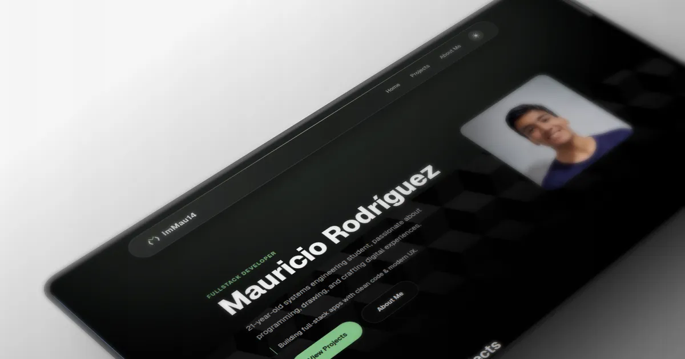

# My Portfolio · [](https://github.com/ImMau14/web-portfolio/actions/workflows/node-ci.yml)

A full-stack developer portfolio built with Astro, showcasing projects, tech stack, and a dynamic About Me page with live GitHub data.

---



---

## Table of Contents

- [About](#about)
- [Features](#features)
- [Technologies](#technologies)
- [Project Structure](#project-structure)
- [Installation & Usage](#installation--usage)
- [Environment Variables](#environment-variables)
- [Vercel Blob Storage](#vercel-blob-storage)
- [Deployment](#deployment)
- [Code Quality](#code-quality)
- [License](#license)

## About

This is my personal portfolio website where I showcase the projects I've built, the technologies I work with, and a bit about my journey as a Systems Engineering student. The site features server-side rendering with Astro, a project management admin panel, and an About Me page that pulls real-time data from the GitHub API.

## Features

- **Featured Projects** — Homepage highlights select projects with GitHub stats
- **Projects Page** — Browse all projects with technology-based filtering
- **About Me** — Profile card with live GitHub data (repos, stars, followers, organizations)
- **Dark / Light Mode** — Theme toggle with system preference detection and localStorage persistence
- **SEO Optimized** — Custom `SeoHead` component with Open Graph and Twitter meta tags
- **Image Optimization** — Astro `Image` component for optimized loading and remote image handling
- **Server-Side GitHub Fetching** — All GitHub API calls run in Astro frontmatter, no client-side requests
- **Admin Panel** — CRUD interface for managing projects (login, create, edit, delete)
- **Responsive Design** — Mobile-first layouts with a floating glassmorphism navbar
- **Glassmorphism UI** — Custom design system with CSS variables for light/dark themes
- **Markdown Content** — Project details rendered with `marked` and styled with Tailwind Typography

## Technologies

| Category | Technology |
| --- | --- |
| Framework | [Astro](https://astro.build) v7 |
| UI Framework | [React](https://react.dev) v19 |
| Styling | [Tailwind CSS](https://tailwindcss.com) v4 |
| Language | [TypeScript](https://www.typescriptlang.org) v6 |
| Database | [Turso](https://turso.tech) (libSQL) via [Drizzle ORM](https://orm.drizzle.team) |
| Auth | JWT (`jsonwebtoken`) + bcrypt |
| Icons | [React Icons](https://react-icons.github.io/react-icons) |
| Animation | [Motion](https://motion.dev) |
| Deployment | [Vercel](https://vercel.com) |
| Linting | [Biome](https://biomejs.dev) |
| Font | [Geist Variable](https://vercel.com/font) |

## Project Structure

<details>
<summary>Click to expand full project structure</summary>

```text
/
├── public/
│   └── favicon.svg
├── src/
│   ├── assets/
│   ├── components/
│   │   ├── about/
│   │   │   ├── Hobbies.astro
│   │   │   ├── Journey.astro
│   │   │   ├── Links.astro
│   │   │   ├── ProfileCard.astro
│   │   │   └── StackSkills.astro
│   │   ├── home/
│   │   │   ├── Contact.astro
│   │   │   ├── Education.astro
│   │   │   ├── FeaturedProjects.astro
│   │   │   ├── Hero.astro
│   │   │   └── TechStack.astro
│   │   ├── projects/
│   │   │   └── GitHubStats.astro
│   │   ├── AmbientGlow.tsx
│   │   ├── Footer.astro
│   │   ├── Header.astro
│   │   ├── Logo.tsx
│   │   ├── SeoHead.astro
│   │   └── ThemeToggle.astro
│   ├── db/
│   │   ├── client.ts
│   │   └── schema.ts
│   ├── features/
│   │   ├── admin/
│   │   │   └── components/
│   │   ├── projects/
│   │   │   ├── components/
│   │   │   ├── projects.service.ts
│   │   │   └── types.ts
│   │   └── theme/
│   │       └── theme-toggle.tsx
│   ├── layouts/
│   │   ├── AdminLayout.astro
│   │   ├── BaseLayout.astro
│   │   └── PublicLayout.astro
│   ├── lib/
│   │   ├── auth.ts
│   │   └── rateLimiter.ts
│   ├── pages/
│   │   ├── admin/
│   │   ├── api/
│   │   ├── projects/
│   │   ├── about.astro
│   │   ├── index.astro
│   │   └── sitemap.xml.ts
│   ├── styles/
│   │   └── global.css
│   ├── env.d.ts
│   └── middleware.ts
├── drizzle/
│   └── migrations/
├── astro.config.mjs
├── biome.json
├── drizzle.config.ts
├── package.json
├── tsconfig.json
└── pnpm-lock.yaml
```

</details>

## Installation & Usage

> [!IMPORTANT]
> **Prerequisites:** [Node.js](https://nodejs.org) 24 LTS or later and [pnpm](https://pnpm.io) 11.6.0 or later.

```sh
# Clone the repository
git clone https://github.com/ImMau14/web-portfolio.git
cd web-portfolio

# Install dependencies
pnpm install

# Start the development server
pnpm dev
```

| Command | Description |
| --- | --- |
| `pnpm install` | Install all dependencies |
| `pnpm dev` | Start the local dev server |
| `pnpm build` | Build the production site to `./dist/` |
| `pnpm preview` | Preview the production build locally |
| `pnpm check` | Run lint, type-check, and format checks |
| `pnpm check:fix` | Auto-fix lint and format issues, then type-check |

> [!NOTE]
> The development server runs at `http://localhost:4321` by default.

## Environment Variables

> [!IMPORTANT]
> The project requires a Turso database and environment variables to function. Without them, the admin panel and project management features will not work.

Copy the example file and fill in your values:

```sh
cp .env.example .env
```

| Variable | Description |
| --- | --- |
| `ASTRO_DB_REMOTE_URL` | Turso database URL (`libsql://<your-base>.turso.io`) |
| `ASTRO_DB_APP_TOKEN` | Turso authentication token |
| `ADMIN_PASSWORD` | Password for the admin panel login |
| `JWT_SECRET` | Secret key used to sign JWT tokens |

> [!NOTE]
> For local development, the `.env` file is sufficient. In production, set these variables in your Vercel dashboard under **Settings → Environment Variables**.

## Vercel Blob Storage

Project images (banners, thumbnails) are stored using [Vercel Blob](https://vercel.com/docs/storage/vercel-blob). To enable image uploads:

1. Go to your project dashboard on [vercel.com](https://vercel.com)
2. Navigate to **Storage** → **Create Store** → **Blob**
3. Name your store and link it to your project
4. Vercel automatically injects the `BLOB_READ_WRITE_TOKEN` environment variable — no manual configuration needed

> [!TIP]
> Vercel Blob is free for hobby projects up to 500 MB of storage and 10 GB of bandwidth per month.

## Deployment

This project is optimized for [Vercel](https://vercel.com) deployment.

1. Push your repository to GitHub
2. Import the repository on [vercel.com/new](https://vercel.com/new)
3. Vercel auto-detects the Astro framework — no configuration needed
4. Set the environment variables listed above in the Vercel dashboard
5. Deploy

> [!TIP]
> The Vercel adapter (`@astrojs/vercel`) is already configured in `astro.config.mjs`. Server-side rendering is enabled by default.

## Code Quality

This project uses [Biome](https://biomejs.dev) for linting and formatting, combined with Astro's built-in type-checker.

| Tool | Purpose |
| --- | --- |
| Biome | Linting, formatting, import sorting |
| TypeScript | Static type checking via `astro check` |
| Tailwind CSS | Utility-first styling with design tokens |

> [!NOTE]
> Running `pnpm check` covers linting, type-checking, and format validation in a single command. Use `pnpm check:fix` to auto-fix issues.

## License

This project is licensed under the [MIT License](./LICENSE).

Copyright (c) 2026 Mauricio "ImMau14" Rodríguez
